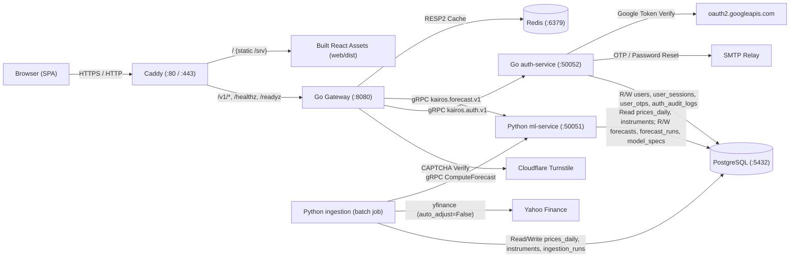
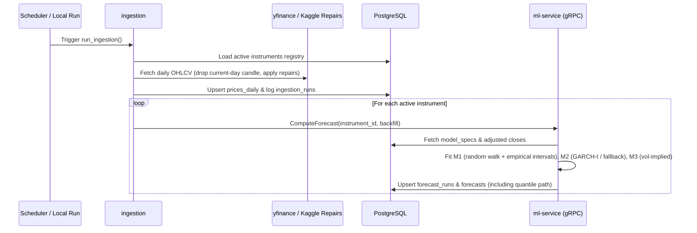

# KAIROS Architecture, Product Spec & ADRs

KAIROS is a split-ready monorepo (`v1.0.0`) for an **end-of-day equity risk monitor**. It computes calibrated uncertainty estimates offline after market close and serves stored forecasts over 7- and 30-day horizons (`h = 7 | 30`).

Companion documents: [README.md](../README.md) · [AGENTS.md](../AGENTS.md) · [DESIGN.md](./DESIGN.md) · Contracts: [api/](../api/)

---

## 1. Product Mandate & Model Positioning

- **Product Scope**: End-of-day risk monitor (case study: IDX digital infrastructure equities `IDX:TLKM`, `IDX:GOTO`, `IDX:DCII`). **Not** a directional price predictor, **not** investment advice, and **not** buy/sell signals. Never claim "real-time" or "enterprise".
- **Measured Walk-Forward Findings (Leak-Free Evaluation, Expanding Window `INIT=500`, `STEP=10`, `h`-Day Embargo)**:
  - **M1 (Price Range)**: Midpoint = random walk (last closing price); 80% and 95% intervals = empirical quantiles of trailing 750-day `h`-day returns (passes 70%–90% nominal coverage: TLKM 76.5%/75.2%, DCII 76.9%/77.6%, GOTO 89.4%/88.9%; ARIMA rMAE ≈ 1.0 and XGBoost rejected).
  - **M2 (Volatility)**: Zero-mean GARCH(1,1)-t (`full` reliability tier on `IDX:TLKM`: QLIKE `rel_const` 0.877 at `h=7`, 0.923 at `h=30`). `IDX:GOTO` (95-day zero-return plateau) and `IDX:DCII` (15.3% non-traded days) use long-run variance with a `LOW RELIABILITY` badge. On GARCH non-convergence, falls back to EWMA/constant variance with status `degraded`.
  - **M3 (Correction Probability)**: Volatility-implied exceedance probability (reflection principle with discrete barrier correction) using frozen threshold $\theta = 0.85 \cdot \sigma_{\text{init}} \cdot \sqrt{h}$ stored in `model_specs`, paired with a 252-day rolling base rate.
  - **Leakage Verification**: Permutation test collapses to naive baseline (`ARIMA` rMAE ≈ 1.000, GARCH `rel_const` ≈ 1.0, M3 AUC ≈ 0.50). Historical chart comparisons replay `ComputeForecast` strictly up to each origin `as_of_date` (labeled `walk-forward (backtest, out-of-sample)` separately from forward forecasts).
- **Non-Goals (V1)**: No intraday/streaming data, no on-demand model training, no serialized model artifact files, and no automated trading/alerting signals.

---

## 2. System Topology

### Daily Batch Ingestion & Forecast Fit Sequence

---

## 3. Read Path, Guest Access & Authentication

1. **Static Delivery & Guest-First Watcher**: Caddy serves the compiled React SPA (`web/dist`) from `/srv` and proxies `/v1/*`, `/healthz`, and `/readyz` to Go `gateway` (`:8080`). Unauthenticated visitors can browse `/`, `/methodology`, and `IDX:TLKM` (`FEATURED TODAY`) on `/watcher` without logging in.
2. **Optional Authentication & Admin Access**: Users unlock all tickers (`IDX:GOTO`, `IDX:DCII`), `/profile`, and (for admin role) `/users` via Google OAuth or local email/password registration + 6-digit email OTP verification. Mutating auth routes are protected by per-IP/email rate limits (`AuthRateLimiter`) and Cloudflare Turnstile verification; sessions use 7-day opaque tokens stored as SHA-256 hashes in PostgreSQL (`kairos_session` cookie or `Bearer` token).
3. **Gateway Caching & Resilience**:
   - `GET /v1/instruments`, `GET /v1/instruments/{id}/forecast?h=7|30`, and `GET /v1/instruments/{id}/history` enforce per-IP token-bucket rate limiting, `X-Request-Id` metadata propagation, Redis caching (300s TTL), and HTTP `Cache-Control: private, max-age=300` + `ETag`/`If-None-Match` (`304 Not Modified`).
   - Protected account endpoints (`/v1/auth/me`, `/v1/auth/profile`, `/v1/auth/google/link`, `/v1/auth/password/change`, `/v1/auth/password/set*`) require valid session middleware (`RequireAuth`); user management endpoints (`/v1/admin/users*`) require `RequireAdmin`; `/v1/admin/refresh` requires `X-Admin-Api-Key` and flushes the Redis forecast/history cache upon completion.
   - `ml-service` reads precomputed rows from PostgreSQL; zero online model training occurs on public requests.

---

## 4. PostgreSQL Table Ownership (Single DB, Strict Ownership)

| Owner | Tables | Access Pattern |
| --- | --- | --- |
| `ingestion` | `instruments`, `prices_daily`, `ingestion_runs` | Writes daily prices & run logs; manages active instrument registry |
| `ml-service` | `model_specs`, `forecast_runs`, `forecasts` | Reads `prices_daily`/`instruments`; reads/writes forecast tables |
| `auth-service` | `users`, `user_sessions`, `user_otps`, `auth_audit_logs` | Stores identities, SHA-256 session hashes, hashed OTP codes, and auth audit events |
| `gateway` | `api_keys` (admin only) | Never queries `prices_*`, `forecast_*`, or `users` via SQL; reads via gRPC only |

---

## 5. Service & Frontend Reference

### `services/gateway` (Go REST Gateway)
- **Contract**: `api/openapi/kairos.v1.yaml` (the only unit serving REST, per ADR-010).
- **Endpoints**:
  - Health: `GET /healthz`, `GET /readyz`
  - Instruments & Forecasts: `GET /v1/instruments`, `GET /v1/instruments/{id}/forecast?h=7|30`, `GET /v1/instruments/{id}/history`
  - Auth: `GET /v1/auth/config`, `GET /v1/auth/google/state`, `POST /v1/auth/google`, `POST /v1/auth/google/link`, `POST /v1/auth/register`, `POST /v1/auth/login`, `POST /v1/auth/otp/verify`, `POST /v1/auth/otp/resend`, `POST /v1/auth/password/forgot`, `POST /v1/auth/password/reset`, `GET /v1/auth/me`, `PATCH /v1/auth/profile`, `POST /v1/auth/password/change`, `POST /v1/auth/password/set/request-otp`, `POST /v1/auth/password/set`, `POST /v1/auth/logout`
  - Admin: `POST /v1/admin/refresh` (`X-Admin-Api-Key`), `GET /v1/admin/users`, `POST /v1/admin/users/{id}/suspend`, `POST /v1/admin/users/{id}/revoke-sessions`, `DELETE /v1/admin/users/{id}`
- **Layout**: `cmd/gateway/main.go` (bootstrap), `internal/routes/` (`routes.go`, domain route files), `internal/handler/` (`handler.go`, `auth.handler.go`, `admin.handler.go`), `internal/services/` (`instrument.service.go`, `forecast.service.go`, `auth.service.go`, `captcha.service.go`), `internal/cache/redis.go`, `internal/middleware/` (`middleware.go`, `auth.middleware.go`, `auth_ratelimit.go`).
- **Proto Stubs & Build**: Go proto stubs are generated at build time (`Dockerfile` / `Makefile`), never committed. `docker build -f services/gateway/Dockerfile -t kairos-gateway .` runs `go test -v ./...`.

### `services/auth-service` (Go gRPC Service)
- **Contract**: `api/proto/kairos/auth/v1/auth.proto` (`kairos.auth.v1.AuthService`).
- **RPCs**:
  - Google & Sessions: `SignInWithGoogle`, `LinkGoogle`, `ValidateSession`, `SignOut`
  - Local Auth & OTP: `Register`, `VerifyOTP`, `ResendOTP`, `LoginWithPassword`, `ForgotPassword`, `ResetPassword`
  - Profile & Password: `UpdateProfile`, `ChangePassword`, `RequestSetPasswordOTP`, `SetPassword`
  - Admin: `ListUsers`, `SetUserSuspended`, `RevokeUserSessions`, `DeleteUser`
- **Layout**: `cmd/auth-service/main.go` (bootstrap), `internal/routes/` (`auth.routes.go`, `health.routes.go`), `internal/handler/servicer.go`, `internal/services/` (`session.service.go`, `google.service.go`, `otp.service.go`, `email.service.go`, `admin.service.go`, `errors.go`), `internal/domain/` (`otp.go`, `password.go`, `validator.go`, `common_passwords.go`), `internal/repository/` (`user.repository.go`, `otp.repository.go`, `admin.repository.go`).

### `services/ml-service` (Python Pure gRPC Server, `grpcio`)
- **Contract**: `api/proto/kairos/forecast/v1/forecast.proto` (`kairos.forecast.v1.ForecastService`).
- **RPCs**: `GetForecast`, `ListInstruments`, `GetHistory`, `ComputeForecast` (internal). Health exposed via gRPC health protocol.
- **Layout**: `src/kairos_ml/server.py` (bootstrap & `SIGTERM`), `src/kairos_ml/routes/` (`forecast_routes.py`, `health_routes.py`), `src/kairos_ml/servicer.py`, `src/kairos_ml/services/` (`instrument_service.py`, `forecast_service.py`), `src/kairos_ml/forecast.py` (separate copy from `ml/kairos_walkforward.py`, verified by `tests/test_golden.py`), `src/kairos_ml/db.py`, `src/kairos_ml/config.py`.

### `services/ingestion` (Python Scheduled Batch Job)
- **Responsibilities**: Loads `status = 'active'` instruments, seeds from `canonical.parquet` (when mounted) and/or fetches EOD OHLCV from `yfinance` (`auto_adjust=False`), drops current-day unfinalized candles (`as_of_date = D-1`), repairs the 8 erroneous `yfinance` zero-volume days using audited Kaggle values while retaining genuine zero-volume days with `is_traded = False`, upserts `prices_daily`, logs `ingestion_runs`, and invokes `ml-service.ComputeForecast` via gRPC.
- **Layout**: `src/kairos_ingestion/ingest.py`, `src/kairos_ingestion/services/forecast_service.py`, `src/kairos_ingestion/validator.py` (tested by `tests/test_validation.py`), `src/kairos_ingestion/db.py`, `src/kairos_ingestion/config.py`.

### `web` (React + TypeScript + Vite + `lightweight-charts`)
- **Design Source of Truth**: [DESIGN.md](./DESIGN.md) (Stockbit-referenced Matte Carbon `#121212` + Signature Emerald `#00AB6B` + Financial Amber `#F59E0B`; zero-symbol rule).
- **Layout**: `src/main.tsx` (bootstrap), `src/routes/` (domain route tables), `src/pages/` (`DashboardPage`, `WatcherPage`, `MethodologyPage`, `LoginPage`, `RegisterPage`, `ForgotPasswordPage`, `ProfilePage`, `AdminUsersPage`), `src/components/`, `src/hooks/`, `src/services/` (`*.service.ts`), `src/i18n/`, `src/styles/` (`tokens.css`, `global.css`, `auth.css`, `chart.css`, `dashboard-motion.css`, `ticker-search.css`), `src/types/`, `src/utils/`.

---

## 6. Architecture Decision Records (ADRs)

| ID | Decision | Status |
| --- | --- | --- |
| ADR-001 | Split-ready monorepo (no cross-service imports; communication strictly via contracts & network) | Accepted |
| ADR-002 | Single VM + Docker Compose deployment; stateless 12-factor K8s-ready design | Accepted |
| ADR-003 | GitHub Actions CI (`gitleaks`, `buf lint`, Python/Go tests, `web` build, Docker Compose + Trivy scan) & Dependabot | Accepted |
| ADR-004 | Market-agnostic core (internal IDs like `IDX:TLKM`, exchange config/calendar separated from logic) | Accepted |
| ADR-005 | Batch forecast computed offline after market close (`D-1`) and stored in DB; no online inference | Accepted |
| ADR-006 | Proto stubs generated at build time (`buf` / `protoc`), never committed to git | Accepted |
| ADR-007 | Plain PostgreSQL as source of truth + Redis ephemeral cache; no message broker | Accepted |
| ADR-008 | Backfilled walk-forward (`as_of_date` replay) for the actual-vs-forecast chart, labeled distinctly from forward forecasts | Accepted |
| ADR-009 | Nightly batch fit for active instruments; no on-demand training (lazy fitting = V2+) | Accepted |
| ADR-010 | Pure gRPC for `ml-service` and `auth-service` (no FastAPI); REST/JSON only at `gateway` | Accepted |
| ADR-011 | V1 serving = fit procedure (`GARCH-t` + empirical intervals + vol-implied M3) + DB parameters; no serialized model files | Accepted |
| ADR-012 | Public read-only dashboard without user login | **Superseded by ADR-016** |
| ADR-013 | `yfinance` (`auto_adjust=False`) as primary EOD source; audited Kaggle dataset strictly for historical repair | Accepted |
| ADR-014 | Model selection: random walk + empirical intervals (M1), GARCH-t / long-run variance fallback (M2), vol-implied (M3) | Accepted |
| ADR-015 | Frontend compiled to static assets and served directly by Caddy | Accepted |
| ADR-016 | Guest-first Watcher (`IDX:TLKM` open) + optional authentication & admin management via `auth-service` (Google OAuth, local email/password + 6-digit OTP, Turnstile CAPTCHA, SHA-256 session tokens) | Accepted |

### Key Decision Details & Roadmap
- **ADR-016 (Superseding ADR-012)**: While `/` and `/methodology` remain public and `/watcher` opens `IDX:TLKM` (`FEATURED TODAY`) for guests, full multi-ticker access (`IDX:GOTO`, `IDX:DCII`), profile settings (`/profile`), and user administration (`/users`) are served through `auth-service` (`kairos.auth.v1`) with strict PostgreSQL table ownership (`users`, `user_sessions`, `user_otps`, `auth_audit_logs`), Cloudflare Turnstile protection, and per-IP/email rate limiting.
- **V2+ Roadmap**: Hybrid lazy fitting (hot/warm/cold tiers) with job queues and single-flight locks, CDN/WAF for distributed DDoS mitigation, live accuracy tracking (`FR-13`) and validated XGBoost challenger promotions, multi-exchange expansion with licensed data feeds, and Azure Container Apps / AKS migration if single-VM memory becomes constrained.
