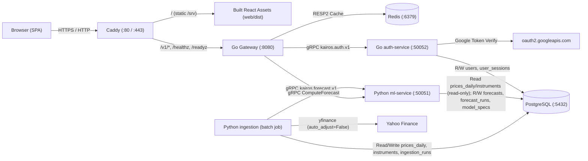
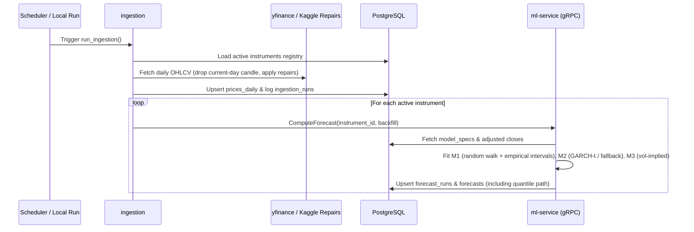

# KAIROS Architecture

KAIROS is a split-ready monorepo for an end-of-day equity risk monitor. It serves calibrated uncertainty intervals (M1), volatility estimates (M2), and volatility-implied correction probabilities (M3) computed offline after market close.

## System Topology

## Daily Batch Ingestion & Forecast Fit Sequence

## Read Path & Caching

1. Browser loads static SPA assets directly from Caddy (`/srv`). Unauthenticated users sign in via Google (`POST /v1/auth/google` → `auth-service` gRPC).
2. Authenticated browser requests `/v1/instruments`, `/v1/instruments/{id}/forecast?h=7|30`, and `/v1/instruments/{id}/history` carrying a `Bearer` token or `kairos_session` cookie.
3. Caddy reverse-proxies `/v1/*` requests to Go `gateway`.
4. `gateway` validates the session via `auth-service` (`ValidateSession` gRPC), enforces per-IP token-bucket rate limiting and `X-Request-Id` propagation, checks Redis (5-minute TTL) + HTTP `ETag`/`If-None-Match` (`304 Not Modified`), and falls back to gRPC calls to `ml-service`.
5. `ml-service` reads precomputed rows from PostgreSQL and returns protobuf messages; zero online model training occurs on public requests.

## PostgreSQL Table Ownership (Strict)

| Owner | Tables | Access Pattern |
| --- | --- | --- |
| `ingestion` | `instruments`, `prices_daily`, `ingestion_runs` | Writes daily prices & run logs; updates insufficient-data metadata |
| `ml-service` | `model_specs`, `forecast_runs`, `forecasts` | Reads `prices_daily`/`instruments`; reads/writes forecast tables |
| `auth-service` | `users`, `user_sessions` | Stores Google identities and SHA-256 hashed session tokens |
| `gateway` | `api_keys` (admin only) | Never queries `prices_*`, `forecast_*`, or `users` via SQL; reads via gRPC only |

## Codebase Layer Organization

Every service and frontend application enforces strict separation of concerns (`AGENTS.md`):

- **Bootstrap (`main.go`, `server.py`, `main.tsx`)**: Environment wiring, dependency setup, graceful `SIGTERM` shutdown only.
- **Routing (`routes/`)**: Domain-split HTTP route groups (`gateway`) or gRPC servicer registration (`ml-service`) or router definitions (`web`).
- **Transport (`handler/`, `servicer.py`, `components/`)**: Thin request/response mapping or presentational UI rendering.
- **Service / Inter-Service Layer (`services/`)**: Domain-split gRPC/HTTP clients and orchestration (`*.service.go`, `*_service.py`, `*.service.ts`).
- **Domain Core (`forecast.py`, `validator.py`, `utils/`)**: Pure numerical/validation logic tested in isolation.
- **Data Access (`db.py`, `internal/cache/`)**: Database queries and Redis operations.
